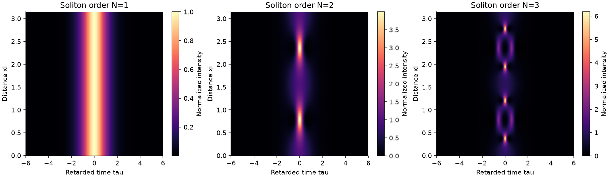
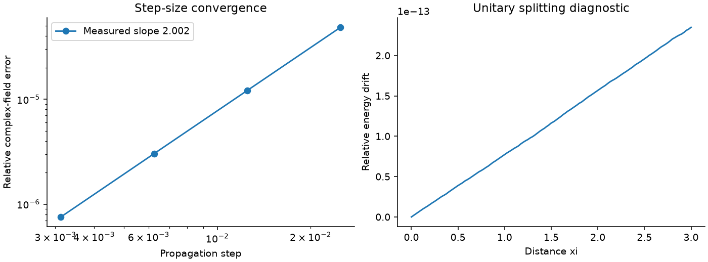

# Nonlinear pulse propagation and chirp-controlled compression

## Standalone repository quick start

This repository contains the complete source, executed notebooks, technical report, retained datasets, figures and project-specific tests. No other project folder is required.

```powershell
python -m venv .venv
.\.venv\Scripts\python.exe -m pip install -e ".[test,notebooks]"
.\.venv\Scripts\python.exe verify.py
.\.venv\Scripts\python.exe -m pytest -q
.\.venv\Scripts\python.exe reproduce.py --profile smoke --run-tag smoke-check
```

Use `.venv/bin/python` on Linux/macOS. Run `reproduce.py --profile standard --run-tag my-run` for the full investigation. The `research` profile is available but its results are not claimed. `run.py` is the baseline; `study.py` contains extensions.

Open `notebooks/` in VS Code and select this virtual environment. `report/technical_report.md` explains the methods and findings. `results/` contains the retained standard study, and `published/manifest.json` records its hashes. `verify.py` is read-only and does not retrain. Prior default results are archived before reproduction; tagged runs leave retained results unchanged.

All data are synthetic. The implementation and initial writing were developed with AI assistance. The cited scientific methods are established; algorithmic novelty is not claimed. `environment-tested.txt` records the full development environment, including optional tools; `pyproject.toml` lists this project's actual installation requirements.


This study asks how a pulse changes when group-velocity dispersion competes with Kerr nonlinearity, and how initial chirp affects the minimum pulse width. It implements symmetric split-step Fourier propagation, verifies analytical limits, compares soliton orders, and scans chirp for a Gaussian pulse.





## Physics and normalization

The implemented equation is

$$i\frac{\partial u}{\partial\xi}+\frac{d}{2}\frac{\partial^2u}{\partial\tau^2}+g|u|^2u=0.$$

For a lossless dimensional fiber, let $\tau=(t-\beta_1z)/T_0$, $\xi=z/L_D$, $L_D=T_0^2/|\beta_2|$, and $A=\sqrt{P_0}u$. Then $d=-\mathrm{sign}(\beta_2)$ and $g=\gamma P_0 L_D=N^2$. Positive d is anomalous dispersion under this convention.

The fundamental solution for d=g=1 is $u=\mathrm{sech}(\tau)e^{i\xi/2}$. The N=2 and N=3 simulations use the same input sech envelope and g=N²; their intensity normalization is therefore the input-normalized field, rather than physical intensity at a shared P0.

## Numerical method

Fourier differentiation replaces $\partial_{\tau\tau}$ with $-\omega^2$. A step h applies linear half-step $e^{-id\omega^2h/4}$, nonlinear full-step $e^{ig|u|^2h}$, then another linear half-step. This Strang splitting has second-order global step-size error for a sufficiently resolved smooth solution. Each substep is norm-preserving, so small energy drift alone cannot demonstrate accurate phase or pulse dynamics.

The grid is periodic and endpoint-excluded. The default domain is [-12,12), with 512 samples. Pulses must remain well localized; periodic wraparound can contaminate the result. Increase both domain and samples for broader pulses or longer propagation.

## Experiments and outputs

For the upgraded full study use `python reproduce.py --profile standard` from this repository root. The original `run.py` remains the baseline. The added `study.py` produces dispersion/SPM separation, collision and recurrence studies, a reusable solver certificate, and grid/window/step diagnostics in `results/advanced_metrics.json`.

Read the [technical report](report/technical_report.md) and work through the [five notebooks](notebooks/). Additional figures are `dispersion_spm.png` and `soliton_collision.png`; `extended_data.npz` retains the trajectories. Frozen results are verified through the root `verify.py`.

Run `python run.py` after installation from this repository root.

- `results/soliton_orders.png`: N=1,2,3 intensity evolution.
- `results/validation.png`: convergence on a nonstationary Gaussian against a much finer SSFM reference, plus energy drift for the fundamental soliton.
- `results/compression.png`: width evolution at three representative chirps.
- `results/study_data.npz`: complex soliton trajectory, grid, full chirp scan and compression distances.
- `results/metrics.json`: exact-soliton field error, measured convergence order, energy drift, and best sampled compression setting.

The chirped Gaussian is $u(0,\tau)=e^{-\tau^2/2}e^{iC\tau^2/2}$. Scan C from -2 to 2 at 25 points with g=2 over 0≤xi≤2. Compression is the minimum RMS intensity width divided by its input value. A minimum at the last distance or a chirp endpoint is a search-boundary result, not an unconstrained optimum. RMS width and FWHM answer different questions when side lobes develop.

## Validation and interpretation

Tests compare dispersion-only propagation with its exact discrete Fourier propagator, SPM-only propagation with its exact local phase, and the fundamental soliton with its analytical solution. Step-halving should reduce splitting error by about four until spatial/periodic errors dominate. Hamiltonian diagnostics are available in the module, but are not exact under splitting and should be used as a separate refinement diagnostic.

This is an ideal cubic NLSE study. It excludes attenuation, third-order dispersion, self-steepening and Raman effects. High-order solitons can demand finer sampling; their plots are qualitative demonstrations unless separately refined. A useful next investigation is a two-dimensional chirp/nonlinearity scan with window and grid refinement at each candidate optimum.

## References

1. G. P. Agrawal, *Nonlinear Fiber Optics*, 6th ed., Academic Press (2019), Chapters 2–5. [Publisher](https://shop.elsevier.com/books/nonlinear-fiber-optics/agrawal/978-0-12-817042-7). Background for the NLSE, normalization, dispersion, Kerr nonlinearity and optical solitons.
2. G. Strang, “On the Construction and Comparison of Difference Schemes,” *SIAM Journal on Numerical Analysis* **5**(3), 506–517 (1968). [DOI](https://doi.org/10.1137/0705041). Mathematical basis for symmetric operator splitting.
3. A. Hasegawa and F. Tappert, “Transmission of stationary nonlinear optical pulses in dispersive dielectric fibers. I. Anomalous dispersion,” *Applied Physics Letters* **23**, 142–144 (1973). [DOI](https://doi.org/10.1063/1.1654836). Foundational theory of bright optical solitons in fibers.
4. L. F. Mollenauer, R. H. Stolen and J. P. Gordon, “Experimental Observation of Picosecond Pulse Narrowing and Solitons in Optical Fibers,” *Physical Review Letters* **45**, 1095–1098 (1980). [DOI](https://doi.org/10.1103/PhysRevLett.45.1095). Experimental context; this project contains simulations, not a reproduction of that experiment.
